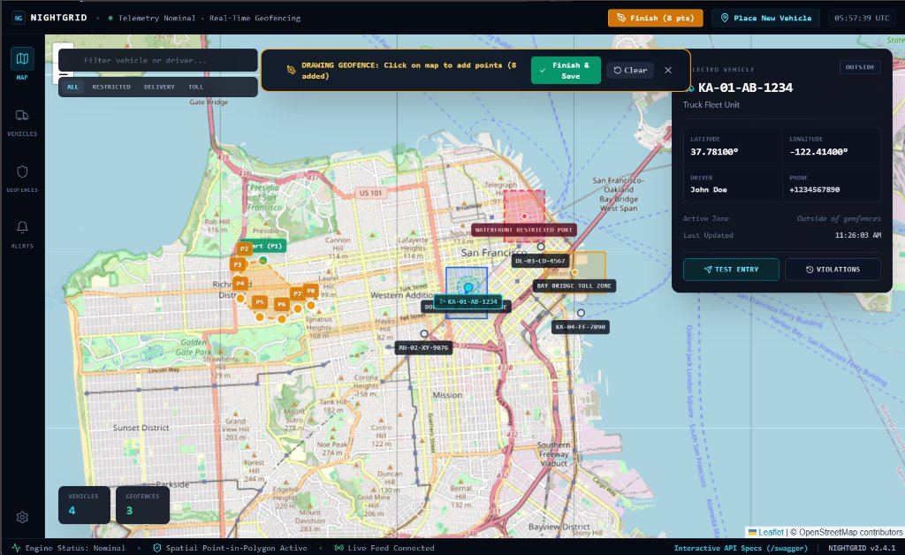

# Nightgrid: Real-Time Fleet Geofencing & Alert System



> **High-Performance Distributed Geofencing & Vehicle Tracking Platform**  
> Built with Go (Clean Architecture, Gin, WebSockets, Ray-Casting Spatial Engine) and React (Vite, TypeScript, Tailwind CSS, Leaflet).

### Live Deployments
- **Backend API**: [https://nightgrid-backend-wje5.onrender.com](https://nightgrid-backend-wje5.onrender.com)
- **Interactive Swagger Docs**: [https://nightgrid-backend-wje5.onrender.com/swagger](https://nightgrid-backend-wje5.onrender.com/swagger)
- **Real-Time WebSocket Feed**: `wss://nightgrid-backend-wje5.onrender.com/ws/alerts`

### Docker Image (Unified Full-Stack)
- **Docker Package Link**: [ghcr.io/rvish-glitch/nightgrid:latest](https://github.com/Rvish-glitch/Nightgrid/pkgs/container/nightgrid)
- **Run with Single Command**:
  ```bash
  docker run -d -p 8080:8080 ghcr.io/rvish-glitch/nightgrid:latest
  ```
  *(Runs complete full-stack app: React Frontend + Go Backend + WebSockets + Spatial Engine on port 8080)*

---

## Overview

**Nightgrid** is an enterprise-grade geofencing and vehicle telemetry platform designed to track mobile assets in real-time, detect boundary transitions across arbitrary polygonal geofences, and broadcast instant security alerts to connected dashboards.

When a vehicle enters or exits a defined virtual boundary—such as delivery zones, restricted territories, or toll corridors—Nightgrid's spatial engine calculates point-in-polygon containment with nanosecond-level efficiency and dispatches notifications via a high-concurrency WebSocket pipeline.

### Core Components
1. **High-Throughput Backend (Go)**: Clean Architecture RESTful API handling geofence definitions, vehicle telemetry ingestion, rule evaluations, and audit logs.
2. **Spatial & Real-Time Engine (Go)**: Ray-Casting point-in-polygon engine with bounding-box optimization and concurrent WebSocket broadcast hub.
3. **Interactive Control Dashboard (React + TypeScript)**: Full-featured visual interface featuring real-time Leaflet maps, polygon drawing tools, live telemetry simulation, and alert feeds.

---

## Key Capabilities

- **Polygonal Geofence Management**: Define, visualize, and persist complex multi-point boundaries categorized by purpose (`delivery_zone`, `restricted_zone`, `toll_zone`, `customer_area`).
- **Telemetry Ingestion & State Tracking**: High-throughput ingestion of GPS coordinates with state transition detection (`entry` / `exit`).
- **Instant Security Alerts**: Automated violation detection against configured rules with instantaneous WebSocket push notifications to operators.
- **Visual Location Simulator**: Interactive map-based telemetry emitter allowing operators and testers to simulate vehicle journeys and trigger edge scenarios on demand.
- **Violation Audit Log**: Queryable historical ledger of all boundary transitions with multi-parameter filtering and execution latency tracking.
- **Performance Benchmarking**: Nanosecond-precision execution timing (`time_ns`) returned in every API response header and payload.

---

## Technology Stack

### Backend
- **Language**: Go 1.22+
- **HTTP Framework**: Gin Engine
- **Spatial Processing**: In-Memory Ray-Casting Algorithm with Bounding-Box Pruning
- **Real-Time Transport**: Concurrency-safe Gorilla WebSockets
- **API Documentation**: Swagger / OpenAPI 3.0 via `swaggo/gin-swagger`
- **Data Persistence**: PostgreSQL with PostGIS extension (with in-memory fallback)

### Frontend
- **Framework**: React 18 (Vite, TypeScript)
- **Styling**: Tailwind CSS & Lucide React Icons
- **Mapping & GIS**: Leaflet & React-Leaflet with polygon draw controls
- **State & Real-Time**: Native WebSocket client with auto-reconnect and toast notification alerts

### Infrastructure & DevOps
- **Containerization**: Docker (Multi-stage build) & Docker Compose
- **Container Registry**: GitHub Container Registry (GHCR)
- **Hosting**: Render (Unified Container) & Cloudflare Pages

---

## Getting Started

### Prerequisites
- [Docker](https://www.docker.com/) & [Docker Compose](https://docs.docker.com/compose/) **or**
- [Go 1.22+](https://golang.org/) & [Node.js 18+](https://nodejs.org/) (or Bun / pnpm)

### Option 1: Run with Docker Compose (Recommended)
Launch the entire stack including the PostGIS database, Go backend, and React dashboard:
```bash
docker-compose up --build
```
- Dashboard: [http://localhost:3000](http://localhost:3000)
- Backend API & Swagger: [http://localhost:8080/swagger](http://localhost:8080/swagger)

### Option 2: Unified Container
Run the pre-built single container image:
```bash
docker run -d -p 8080:8080 ghcr.io/rvish-glitch/nightgrid:latest
```
Access the application at [http://localhost:8080](http://localhost:8080).

### Option 3: Local Development

#### 1. Backend Setup
```bash
cd backend
go mod download
go run cmd/server/main.go
```
The Go server starts on `http://localhost:8080`.

#### 2. Frontend Setup
```bash
cd frontend
npm install   # or bun install / pnpm install
npm run dev   # or bun run dev / pnpm dev
```
The Vite development server opens on `http://localhost:3000`.

---

## Performance & API Specifications

### Execution Timing
Every API response strictly contains the execution time in nanoseconds measured at the request boundary:

```json
{
  "time_ns": "1234567"
}
```

---

## API Endpoints

### 1. POST /geofences
Create a new geofence with polygonal boundaries.

**Request Body**:
```json
{
  "name": "Downtown Delivery Zone",
  "description": "Main delivery area for downtown customers",
  "coordinates": [
    [37.7749, -122.4194],
    [37.7849, -122.4194],
    [37.7849, -122.4094],
    [37.7749, -122.4094],
    [37.7749, -122.4194]
  ],
  "category": "delivery_zone"
}
```

**Field Descriptions**:
- `name` (string, required): Human-readable name for the geofence
- `description` (string, optional): Detailed description of the geofence purpose
- `coordinates` (array, required): Array of `[latitude, longitude]` coordinate pairs defining the polygon boundary
- `category` (string, required): Type of geofence - one of: `delivery_zone`, `restricted_zone`, `toll_zone`, `customer_area`

**Validation Rules**:
- `coordinates`: Array of `[latitude, longitude]` pairs
- First and last coordinates must be identical (closed polygon)
- Minimum 4 points (3 unique + 1 closing point)
- Latitude must be between -90 and 90
- Longitude must be between -180 and 180

**Response**:
```json
{
  "id": "geo_123",
  "name": "Downtown Delivery Zone",
  "status": "active",
  "time_ns": "1234567"
}
```

---

### 2. GET /geofences
Retrieve all geofences with optional category filtering.

**Query Parameters**:
- `category` (optional): Filter by geofence category (`delivery_zone`, `restricted_zone`, etc.)

**Example**: `GET /geofences?category=delivery_zone`

**Response**:
```json
{
  "geofences": [
    {
      "id": "geo_123",
      "name": "Downtown Delivery Zone",
      "description": "Main delivery area for downtown customers",
      "coordinates": [[37.7749, -122.4194], [37.7849, -122.4194], [37.7849, -122.4094], [37.7749, -122.4094], [37.7749, -122.4194]],
      "category": "delivery_zone",
      "created_at": "2025-01-15T10:30:00Z"
    }
  ],
  "time_ns": "987654"
}
```

---

### 3. POST /vehicles
Register a new vehicle in the fleet.

**Request Body**:
```json
{
  "vehicle_number": "KA-01-AB-1234",
  "driver_name": "John Doe",
  "vehicle_type": "truck",
  "phone": "+1234567890"
}
```

**Field Descriptions**:
- `vehicle_number` (string, required): Unique vehicle registration number
- `driver_name` (string, required): Name of the assigned driver
- `vehicle_type` (string, required): Type of vehicle (e.g., `truck`, `car`, `van`, `motorcycle`)
- `phone` (string, required): Contact phone number for the driver

**Response**:
```json
{
  "id": "veh_456",
  "vehicle_number": "KA-01-AB-1234",
  "status": "active",
  "time_ns": "1123456"
}
```

---

### 4. GET /vehicles
Retrieve all registered fleet vehicles.

**Response**:
```json
{
  "vehicles": [
    {
      "id": "veh_456",
      "vehicle_number": "KA-01-AB-1234",
      "driver_name": "John Doe",
      "vehicle_type": "truck",
      "phone": "+1234567890",
      "status": "active",
      "created_at": "2025-01-15T09:00:00Z"
    }
  ],
  "time_ns": "876543"
}
```

---

### 5. POST /vehicles/location
Update vehicle telemetry position and evaluate geofence transitions. **Triggers real-time alerts upon entering restricted zones or configured alert boundaries.**

**Request Body**:
```json
{
  "vehicle_id": "veh_456",
  "latitude": 37.7849,
  "longitude": -122.4194,
  "timestamp": "2025-01-15T10:35:00Z"
}
```

**Field Descriptions**:
- `vehicle_id` (string, required): ID of the vehicle being updated
- `latitude` (float, required): Current latitude coordinate (-90 to 90)
- `longitude` (float, required): Current longitude coordinate (-180 to 180)
- `timestamp` (string, required): ISO 8601 timestamp of location capture

**Response**:
```json
{
  "vehicle_id": "veh_456",
  "location_updated": true,
  "current_geofences": [
    {
      "geofence_id": "geo_123",
      "geofence_name": "Downtown Delivery Zone",
      "status": "inside"
    }
  ],
  "time_ns": "2345678"
}
```

**Processing Pipeline**:
- Persists telemetry record in the data store.
- Evaluates spatial containment against all active geofence polygons.
- Compares with previous vehicle state to detect `entry` or `exit` transitions.
- Dispatches real-time WebSocket notifications to connected dashboards.
- Returns list of current zones containing the vehicle.

---

### 6. GET /vehicles/location/{vehicle_id}
Get current position, timestamp, and active geofence status for a vehicle.

**Response**:
```json
{
  "vehicle_id": "veh_456",
  "vehicle_number": "KA-01-AB-1234",
  "current_location": {
    "latitude": 37.7849,
    "longitude": -122.4194,
    "timestamp": "2025-01-15T10:35:00Z"
  },
  "current_geofences": [
    {
      "geofence_id": "geo_123",
      "geofence_name": "Downtown Delivery Zone",
      "category": "delivery_zone"
    }
  ],
  "time_ns": "876543"
}
```

---

### 7. POST /alerts/configure
Configure custom alert triggers for geofence events.

**Request Body**:
```json
{
  "geofence_id": "geo_123",
  "vehicle_id": "veh_456",
  "event_type": "entry"
}
```

**Field Descriptions**:
- `geofence_id` (string, required): Geofence ID to monitor
- `vehicle_id` (string, optional): Specific vehicle ID (omitted to monitor all vehicles)
- `event_type` (string, required): Event trigger type - `entry`, `exit`, or `both`

**Response**:
```json
{
  "alert_id": "alert_789",
  "geofence_id": "geo_123",
  "vehicle_id": "veh_456",
  "event_type": "entry",
  "status": "active",
  "time_ns": "1567890"
}
```

---

### 8. GET /alerts
Retrieve all configured alert triggers.

**Query Parameters**:
- `geofence_id` (optional): Filter rules by geofence ID
- `vehicle_id` (optional): Filter rules by vehicle ID

**Response**:
```json
{
  "alerts": [
    {
      "alert_id": "alert_789",
      "geofence_id": "geo_123",
      "geofence_name": "Downtown Delivery Zone",
      "vehicle_id": "veh_456",
      "vehicle_number": "KA-01-AB-1234",
      "event_type": "entry",
      "status": "active",
      "created_at": "2025-01-15T09:15:00Z"
    }
  ],
  "time_ns": "654321"
}
```

---

### 9. GET /violations/history
Query historical boundary transition events and violations.

**Query Parameters**:
- `vehicle_id` (optional): Filter by vehicle ID
- `geofence_id` (optional): Filter by geofence ID
- `start_date` (optional): ISO 8601 start timestamp
- `end_date` (optional): ISO 8601 end timestamp
- `limit` (optional): Number of records (default: 50, max: 500)

**Example**: `GET /violations/history?vehicle_id=veh_456&limit=100`

**Response**:
```json
{
  "violations": [
    {
      "id": "viol_111",
      "vehicle_id": "veh_456",
      "vehicle_number": "KA-01-AB-1234",
      "geofence_id": "geo_123",
      "geofence_name": "Downtown Delivery Zone",
      "event_type": "entry",
      "latitude": 37.7849,
      "longitude": -122.4194,
      "timestamp": "2025-01-15T10:35:00Z"
    }
  ],
  "total_count": 245,
  "time_ns": "3456789"
}
```

---

## Real-Time Alert Engine

Nightgrid features an asynchronous event-driven notification hub powered by WebSockets. When incoming telemetry satisfies alert criteria or breaches a restricted zone, the system immediately delivers the event payload to all active clients.

### WebSocket Endpoint: `/ws/alerts`

**Connection Lifecycle & Architecture**:
1. Client establishes connection over `ws://` (or `wss://` in production).
2. The Go WebSocket Hub registers the client channel in a thread-safe registry.
3. Telemetry events trigger non-blocking broadcasts to avoid HTTP request degradation.
4. Heartbeat pings ensure connection health and automatic reconnect handling.

**WebSocket Message Schema**:
```json
{
  "event_id": "evt_999",
  "event_type": "entry",
  "timestamp": "2025-01-15T10:35:00Z",
  "vehicle": {
    "vehicle_id": "veh_456",
    "vehicle_number": "KA-01-AB-1234",
    "driver_name": "John Doe"
  },
  "geofence": {
    "geofence_id": "geo_123",
    "geofence_name": "Downtown Delivery Zone",
    "category": "delivery_zone"
  },
  "location": {
    "latitude": 37.7849,
    "longitude": -122.4194
  }
}
```

---

## Frontend Web Dashboard

The web dashboard provides an interactive management interface built with React, Vite, Tailwind CSS, and Leaflet:

1. **Interactive Geospatial Map**:
   - Visualizes all geofences as color-coded polygons (Red: Restricted, Blue: Delivery, Amber: Toll, Purple: Customer).
   - Renders current vehicle positions with dynamic status badges.
2. **Polygon Drawing Controls**:
   - Draw custom geofences directly on the map interface.
   - Real-time coordinate validation and boundary closure.
3. **Interactive Telemetry Simulator**:
   - Select any registered vehicle and click on the map to emit GPS updates.
   - Instantly verify geofence containment and trigger live WebSocket alerts.
4. **Live Alert Notification Stream**:
   - Dedicated real-time alert feed with sound alerts and toast notifications.
   - Displays vehicle, zone category, transition type, and precise coordinates.
5. **Historical Violation Audit**:
   - Searchable, filterable audit log of historical movements and violations with pagination.

---

## Spatial Point-in-Polygon Engine

Nightgrid implements a high-performance **Ray-Casting Algorithm** (Jordan curve theorem) with spatial optimizations:

- **Bounding Box Pre-check**: Computes minimum and maximum latitude/longitude extents for each polygon. Points falling outside the bounding box are discarded in $O(1)$ time without evaluating vertices.
- **Ray-Casting Intersection**: Counts the number of times a horizontal ray from the point intersects polygon edges. An odd number of intersections indicates the point lies inside the boundary.
- **Edge Precision**: Safely handles horizontal edges, collinear points, and vertex intersections without false positives.

---

## License & Contributing

Distributed under the MIT License. Contributions, issues, and feature requests are welcome!
